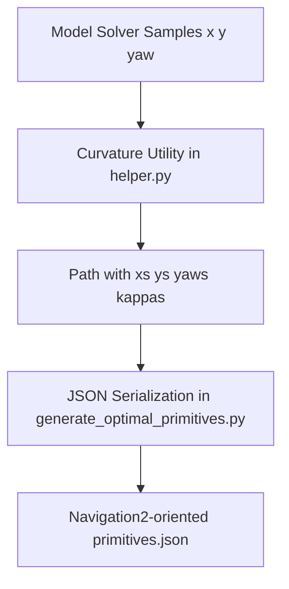

# Design Document

## Overview

The primitives-curvature feature adds curvature as a first-class trajectory state dimension for generated primitives while preserving compatibility with Navigation2-oriented primitive consumers. The design extends existing trajectory data structures and JSON serialization so each sampled pose can expose curvature in a deterministic, documented way, with explicit fallback behavior for models where curvature is not directly meaningful.

Curvature is represented as kappa = d(theta)/ds with units `1/m`, sampled at the same indices as position and heading samples. The implementation is centered on post-solve geometric derivation from sampled trajectories to keep model solvers stable and avoid invasive changes to existing OCP formulations.

## Steering Document Alignment

### Technical Standards (tech.md)
- Follows the Navigation2-first output contract by extending primitive output schema in a backward-compatible way.
- Keeps monolithic module boundaries intact (entrypoint/orchestrator/model/data utility separation) and introduces focused curvature computation/serialization utilities.
- Uses existing Python scientific stack (NumPy/CasADi/Rockit), with no new mandatory runtime dependency.

### Project Structure (structure.md)
- Extends core trajectory domain objects in existing domain modules rather than introducing cross-cutting logic in the entrypoint.
- Keeps serialization concerns in generation output logic while delegating curvature math to a dedicated helper.
- Maintains dependency direction: entry layer -> orchestrators -> domain/model/utilities.

## Code Reuse Analysis

### Existing Components to Leverage
- **Path dataclass (`trajectory.py`)**: Extend to hold curvature samples aligned with existing `xs`, `ys`, `yaws` arrays.
- **Output formatting (`Path.to_output_format`)**: Reuse normalization and rounding flow, adding curvature emission and legacy mode support.
- **Trajectory creation (`trajectory_generator.py`)**: Reuse sampled `xs`, `ys`, `yaws`; append curvature derivation after solve.
- **JSON writer (`generate_optimal_primitives.py`)**: Reuse primitive assembly flow and add schema version/metadata updates.
- **Math helper module (`helper.py`)**: Add curvature computation utilities and validation helpers.

### Integration Points
- **Navigation2 primitive output contract**: Integrate curvature in a backward-compatible way while preserving existing fields and parser compatibility options.
- **Reference schema contract**: Curvature-enabled outputs must match the structure used in `sample_primitives/ackermann_with_curvature.json` (metadata-level curvature catalog, 4-value pose samples, primitive-level curvature start/end fields and indices).
- **Local JSON storage (`outputs/*/primitives.json`)**: Add metadata declarations for curvature units/sign/fallback semantics and consistent sample alignment.

## Architecture

The feature is implemented as a data-flow extension on top of the current pipeline:
1. Solver modules produce sampled `x`, `y`, `yaw` trajectories as today.
2. Curvature utility computes per-sample $\kappa$ from sampled geometry (with endpoint-safe finite differences).
3. Path object stores curvature alongside existing pose arrays.
4. Serializer writes curvature in output samples and adds lattice metadata/version markers.
5. Validation guards enforce equal lengths and bounded/finite curvature values before writing.

### Modular Design Principles
- **Single File Responsibility**: Curvature math in helper utility; trajectory container changes in `trajectory.py`; serialization changes in `generate_optimal_primitives.py`.
- **Component Isolation**: Model OCP files (`bicycle_acc.py`, `unicycle_acc.py`, `omni_acc.py`) remain focused on dynamics and solving.
- **Service Layer Separation**: Computation (curvature derivation), domain storage (Path), and persistence (JSON writer) remain separated.
- **Utility Modularity**: Curvature computation and validation are small pure functions to ease testing.



## Components and Interfaces

### Curvature Utility
- **Purpose:** Compute stable curvature samples from trajectory samples.
- **Interfaces:**
  - `compute_curvature_samples(xs, ys, yaws) -> np.ndarray`
  - `clamp_or_validate_curvature(kappas, motion_model, config) -> np.ndarray`
- **Dependencies:** NumPy, existing angle helpers.
- **Reuses:** Existing path samples from `trajectory_generator.py`.

### Path Data Model Extension
- **Purpose:** Carry curvature through pipeline with strict sample alignment.
- **Interfaces:**
  - `Path(xs, ys, yaws, kappas)`
  - `Path.to_output_format(include_curvature: bool = True)`
- **Dependencies:** NumPy and angle normalization.
- **Reuses:** Existing `Path` serialization behavior and rounding conventions.

### Output Schema Adapter
- **Purpose:** Serialize curvature and metadata while maintaining legacy compatibility and enforcing sample-schema parity with `sample_primitives/ackermann_with_curvature.json`.
- **Interfaces:**
  - `write_to_json(..., config)` extended for curvature metadata catalog and primitive-level curvature index fields.
- **Dependencies:** Existing header/writer functions.
- **Reuses:** Existing primitive iteration and indexing logic.

### Curvature Validation Layer
- **Purpose:** Enforce deterministic shape/range guarantees before file output.
- **Interfaces:**
  - `validate_curvature_alignment(path)`
  - `validate_curvature_values(kappas, constraints)`
- **Dependencies:** NumPy and config constraints.
- **Reuses:** Existing config parsing and model dispatch.

## Data Models

### Path (extended)
```text
Path
- xs: np.ndarray[float]             # shape (N,)
- ys: np.ndarray[float]             # shape (N,)
- yaws: np.ndarray[float]           # shape (N,)
- kappas: np.ndarray[float]         # shape (N,), units 1/m

Constraints:
- len(xs) == len(ys) == len(yaws) == len(kappas)
- kappas must be finite (no NaN/Inf)
```

### Primitive Output Sample Schema
```text
Primitive Pose Sample (curvature-enabled)
- x: float
- y: float
- yaw: float
- curvature: float

Legacy Compatibility:
- Existing 3-element pose samples remain readable
- Serializer emits curvature-enabled format by default
- Metadata indicates curvature presence and semantics
```

### Curvature Catalog and Primitive Fields (sample schema parity)
```text
lattice_metadata additions (exact contract target)
- num_of_curvatures: int
- curvatures: list[float]                    # ordered global curvature catalog

primitive additions (per trajectory)
- poses: list[list[float, float, float, float]]
- start_curvature: float
- end_curvature: float
- start_curvature_index: int                 # index in lattice_metadata.curvatures
- end_curvature_index: int                   # index in lattice_metadata.curvatures

Required consistency rules
- Every pose entry has exactly 4 values in curvature-enabled outputs
- start_curvature == poses[0][3]
- end_curvature == last non-empty pose sample curvature
- start_curvature_index/end_curvature_index map exactly to lattice_metadata.curvatures
- num_of_curvatures == len(lattice_metadata.curvatures)
```

### Lattice Metadata Additions
```text
lattice_metadata additions
- curvature_included: bool
- curvature_units: "1/m"
- curvature_sign_convention: string
- curvature_fallback_policy: string
- primitive_schema_version: string (or bumped numeric version)
```

## Error Handling

### Error Scenarios
1. **Sample Length Mismatch**: Curvature array length differs from `xs/ys/yaws`.
   - **Handling:** Raise explicit validation error before JSON write; abort file generation.
   - **User Impact:** Clear message indicating which primitive/sample set is inconsistent.

2. **Invalid Curvature Values**: NaN/Inf or out-of-bounds curvature produced.
   - **Handling:** Apply configured fallback or fail-fast in strict mode with diagnostics.
   - **User Impact:** Actionable error with offending primitive/model and suggested config fix.

3. **Schema Contract Mismatch**: Generated file deviates from `sample_primitives/ackermann_with_curvature.json` curvature structure.
  - **Handling:** Fail validation and report exact missing/malformed fields (for example missing `num_of_curvatures`, wrong pose length, invalid curvature indices).
  - **User Impact:** Clear fix guidance before artifacts are accepted.

4. **Legacy Input Without Curvature**: Consumer/tool expects curvature but file is old format.
   - **Handling:** In compatibility mode, infer/default curvature; in strict mode, throw explicit schema error.
   - **User Impact:** Predictable behavior tied to mode selection, no silent corruption.

5. **Model-Specific Ambiguity**: Model cannot provide physically meaningful curvature at certain samples.
   - **Handling:** Use documented fallback policy (`0.0` or geometric estimate) and annotate in metadata.
   - **User Impact:** Output remains consumable with clear semantics.

## Testing Strategy

### Unit Testing
- Test curvature utility on straight line, constant-radius arc, and mixed trajectories.
- Verify numerical stability at trajectory endpoints and very short segments.
- Validate `Path.to_output_format` emits aligned 4-value samples in curvature-enabled mode.
- Validate fallback and strict-mode behavior for invalid inputs.

### Integration Testing
- Run generation for diff/ackermann/omni configs and assert:
  - Curvature field present per sample.
  - Pose samples follow 4-value format `[x, y, yaw, curvature]`.
  - Sample counts match (`x/y/yaw/curvature`).
  - Metadata includes `num_of_curvatures` and `curvatures` and they are consistent.
  - Primitive fields include `start_curvature`, `end_curvature`, `start_curvature_index`, `end_curvature_index` and index mapping is correct.
- Validate backward compatibility by loading legacy sample files and ensuring parser behavior matches mode.

### End-to-End Testing
- Generate primitives from CLI for each model and verify output JSON is Navigation2-compatible plus curvature extension.
- Compare runtime against baseline to ensure added processing remains within the less-than-or-equal-to 10% performance target.
- Execute analysis/visualization flow to ensure curvature-enabled outputs do not break existing plotting and artifact generation workflows.
